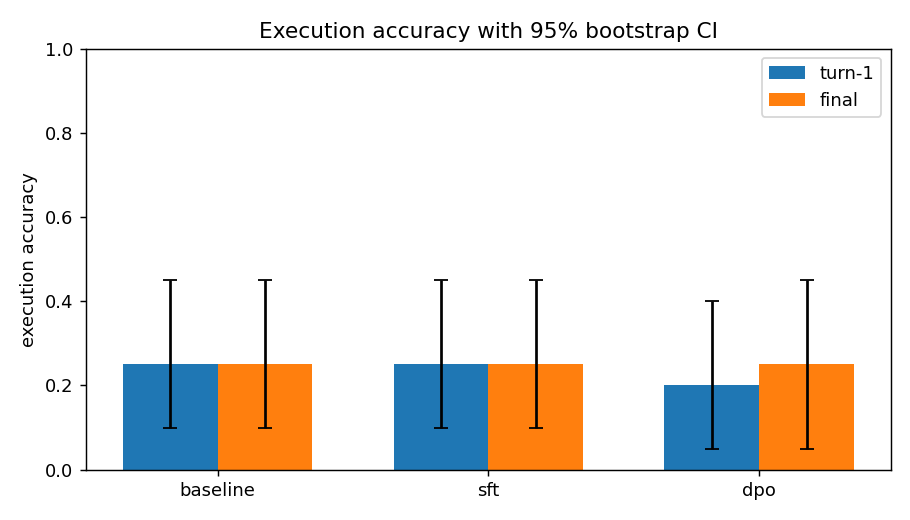
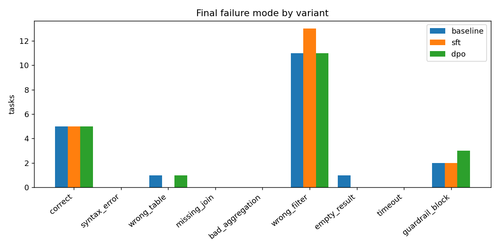
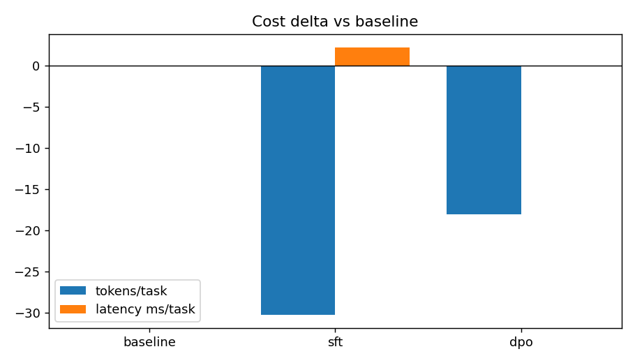

# TraceToPolicy

**Post-training an NL-to-SQL LLM agent on its own execution traces, with a continuous-learning loop and promotion gating.**

TraceToPolicy runs a small open-weights instruct model as a natural-language-to-SQL agent
against a local DuckDB warehouse, records *every* attempt as a JSONL trace (first-try
successes, failures, and multi-turn repairs), turns those traces into SFT and DPO training
sets using **differential execution correctness** as the reward, post-trains the model with
LoRA, evaluates baseline vs SFT vs DPO on a held-out split with bootstrap confidence
intervals, and then wires a scheduled retraining loop that only promotes a new model when it
passes an eval **regression gate** — rolling back on any failure-mode or cost regression.

No human labels and no LLM judge: the warehouse is the reward signal.

---

## Architecture

```
        data/tasks.jsonl  (138 hand-written NL->SQL tasks, 6-table schema)
                │
                │  splits.py  (deterministic 70 / 15 / 15)
                ▼
   ┌──────────────────────────────────────────────┐
   │ DuckDB warehouse  (warehouse.py, ~54k rows)  │
   │ customers · products · orders · order_items  │
   │ events · subscriptions                       │
   └───────────────────────┬──────────────────────┘
                           ▼
   ┌──────────────────────────────────────────────┐        JSONL traces
   │ NL-to-SQL agent  (agent.py)                  │  ──►  data/traces_train.jsonl
   │ propose → execute → repair (≤3 turns)        │       (3,181 records) with
   │ SELECT-only guardrail (sqlglot + regex)      │       failure_mode taxonomy
   └───────────────────────┬──────────────────────┘
                           ▼
   ┌──────────────────────────────────────────────┐
   │ labeling.py — differential-execution reward  │
   │  • SFT: shortest correct SQL, repair-aware    │
   │  • DPO: {prompt, chosen, rejected}, deduped  │
   └───────────────────────┬──────────────────────┘
                           ▼
   ┌──────────────────────────────────────────────┐
   │ train_sft.py → train_dpo.py  (TRL + PEFT)    │
   │ LoRA (QLoRA on CUDA ≥24GB); SFT adapter is   │
   │ the frozen DPO reference                     │
   └───────────────────────┬──────────────────────┘
                           ▼
   ┌──────────────────────────────────────────────┐
   │ eval.py — baseline vs SFT vs DPO             │
   │ execution acc@1/@final, 10k bootstrap CIs,   │
   │ win/tie/loss, failure-mode deltas, cost       │
   └───────────────────────┬──────────────────────┘
                           ▼
   ┌──────────────────────────────────────────────┐
   │ loop.py — continuous learning + gate         │
   │ harvest → label → SFT/DPO → regression suite │
   │ promotion only if accuracy improves & no     │
   │ mode/cost regression, else rollback          │
   │ artifacts/registry.json                      │
   └───────────────────────┬──────────────────────┘
                           ▼
   ┌──────────────────────────────────────────────┐
   │ monitoring.py (Prometheus /metrics)          │
   │ dashboard.py  → results/dashboard.html       │
   │ drift.py      → train/live PSI + KL          │
   └──────────────────────────────────────────────┘
```

### Modules

| module | job |
|---|---|
| `model_config.py` | Detects hardware and picks the largest trainable model tier; records the choice in every artifact. |
| `warehouse.py` | Builds the seeded DuckDB warehouse; `run_sql` (with timeout) and `results_equal` (order-insensitive, type-tolerant differential comparison). |
| `splits.py` | Deterministic train/dev/test split + the hard leakage assertion. |
| `agent.py` | Multi-turn propose/execute/repair loop, SELECT-only guardrail, failure-mode taxonomy, JSONL tracing. |
| `inference.py` | One `Generator` interface; `VLLMGenerator` (CUDA) and `HFGenerator` (transformers) auto-selected. |
| `labeling.py` | Differential-execution reward, SFT/DPO dataset construction, dedup, leakage guard. |
| `train_sft.py` / `train_dpo.py` | LoRA/QLoRA SFT and DPO with TRL + PEFT, W&B-offline logging, model cards. |
| `trl_patches.py` | Pure-PyTorch replacement for TRL's Triton fused LM head (so training works on CPU / Apple Silicon). |
| `eval.py` | Held-out evaluation with 10k-sample bootstrap CIs, paired win-rate deltas, figures. |
| `loop.py` | Continuous-learning cycles, promotion gate, registry, rollback. |
| `drift.py` | PSI/KL between training and live trace distributions. |
| `monitoring.py` | Prometheus counters/gauges/histograms + `/metrics` endpoint. |
| `dashboard.py` | Static, self-contained HTML dashboard from the registry + eval history. |
| `cli.py` | `warehouse`, `harvest`, `label`, `eval`, `loop`, `dashboard`, `info`. |
| `airflow/dags/tracetopolicy_dag.py` | Daily DAG (harvest → label → train → gate → promote/rollback), import-safe without Airflow, also runnable as a plain CLI. |

---

## How to run

```bash
make setup        # create .venv (Python 3.11) and install dependencies
make warehouse    # build the DuckDB warehouse (~54k rows, fixed seed)
make traces       # harvest agent traces on the train split (→ data/traces_train.jsonl)
make label        # build SFT + DPO datasets (→ data/datasets/)
make sft          # LoRA SFT           (→ artifacts/sft)
make dpo          # LoRA DPO from SFT  (→ artifacts/dpo)
make eval         # baseline vs SFT vs DPO (→ results/)
make loop         # 2 continuous-learning cycles (→ artifacts/registry.json)
make dashboard    # → results/dashboard.html
make test         # fast, offline test suite
make all          # everything, in order
```

Individual stages are also reachable through the CLI, e.g.:

```bash
python -m tracetopolicy.cli harvest --split train --samples-per-task 12 --out data/traces_train.jsonl
python -m tracetopolicy.cli label   --traces data/traces_train.jsonl --outdir data/datasets
python -m tracetopolicy.cli info
```

### Hardware tiers

`resolve_model_config()` probes the runtime and picks the largest model that actually trains:

| tier | detected when | base model | adaptation | steps (SFT / DPO) |
|---|---|---|---|---|
| `cuda_24gb` | CUDA with ≥24 GB VRAM | `Qwen/Qwen2.5-7B-Instruct` | QLoRA (4-bit) | 120 / 60 |
| `cuda_small` | CUDA with <24 GB VRAM | `Qwen/Qwen2.5-1.5B-Instruct` | LoRA | 120 / 60 |
| `cpu_apple` | CPU / Apple Silicon only | `Qwen/Qwen2.5-0.5B-Instruct` | LoRA, reduced steps | 60 / 30 |

If a model download fails, the loader retries once then falls back to the next smaller tier and
notes it. The resolved tier is written into every `model_card.json`.

**This build ran on the `cpu_apple` tier** (see below), because the machine has no CUDA GPU.

### Switching inference backends

`get_generator()` selects **vLLM** automatically when a CUDA GPU and the `vllm` package are
present, otherwise the plain **transformers** backend. Force it explicitly with
`--backend transformers|vllm`. Device and tier can be overridden with the
`TRACETOPOLICY_DEVICE` and `TRACETOPOLICY_TIER` environment variables. On this Apple-Silicon
build the pipeline runs on **CPU** rather than MPS: the MPS caching allocator fragments under
long, variable-length batched generation and never returns the memory, which pushes the host
into swap on multi-thousand-generation harvests.

---

## Results (this build)

All numbers below are read from `results/*.json`; nothing is hand-entered.

**Hardware / model**

| | |
|---|---|
| Machine | Apple M3, 8 cores, 16 GB, no CUDA (MPS present, unused) |
| Tier | `cpu_apple` → `Qwen/Qwen2.5-0.5B-Instruct` |
| LoRA | r=8, α=16, dropout=0.05, targets q/k/v/o/gate/up/down_proj |
| Device / dtype | `cpu`, float32 |

**Datasets**

| artifact | count |
|---|---|
| tasks (train / dev / test) | 138 (97 / 21 / 20) |
| traces harvested (train) | 3,181 |
| SFT examples | 42 (5 repair-derived) |
| DPO preference pairs | 121 over 41 tasks |

Rejected samples are stratified across failure modes: `wrong_filter` 48, `guardrail_block` 39,
`wrong_table` 13, `empty_result` 11, `syntax_error` 9, `missing_join` 1.

**Training**

| stage | steps | examples | loss | final reward margin | wall-clock |
|---|---|---|---|---|---|
| SFT | 60 | 42 | 0.366 | — | 5.3 min |
| DPO | 12 | 121 | 0.410 | +1.44 | 1.5 min |

DPO started from the SFT adapter with the (merged, frozen) SFT model as the reference
(β=0.5). An earlier aggressive DPO run (β=0.1, lr=1e-4, 30 steps) over-optimized — reward
margin reached +10.5 and held-out accuracy collapsed to 0.05 — so it was retuned; the numbers
above are from the shipped conservative run.

**Held-out evaluation** (test split, 20 tasks, greedy, 10k bootstrap samples)

| variant | acc@1 | acc@1 95% CI | final acc | final 95% CI | turns-to-success | guardrail-violation rate | tok/task | ms/task | win/tie/loss vs baseline | win rate |
|---|---|---|---|---|---|---|---|---|---|---|
| baseline | 0.250 | [0.100, 0.450] | 0.250 | [0.100, 0.450] | 1.00 | 0.100 | 1030 | 4 | — | — |
| sft | 0.250 | [0.100, 0.450] | 0.250 | [0.100, 0.450] | 1.00 | 0.200 | 999 | 7 | 1 / 18 / 1 | 0.050 |
| dpo | 0.200 | [0.050, 0.400] | 0.250 | [0.050, 0.450] | 1.20 | 0.157 | 1012 | 4 | 2 / 16 / 2 | 0.100 |

On this tier the post-training is **effectively neutral on the held-out split**: the point
estimates match baseline and every bootstrap CI overlaps heavily. DPO is the least destructive
of the two — it keeps final accuracy at 0.250, resolves one previously-empty result and adds
one guardrail block, and slightly lowers token cost relative to SFT.

**Per-failure-mode delta vs baseline** (negative = improved)

| variant | correct | syntax_error | wrong_table | missing_join | bad_aggregation | wrong_filter | empty_result | timeout | guardrail_block |
|---|---|---|---|---|---|---|---|---|---|
| sft | 0 | 0 | −1 | 0 | 0 | +2 | −1 | 0 | 0 |
| dpo | 0 | 0 | 0 | 0 | 0 | 0 | −1 | 0 | +1 |





### Continuous-learning loop (2 real cycles)

`make loop` harvested live traces with the current model, labeled them, trained an incremental
SFT+DPO, and ran the regression gate. The registry recorded one promotion and one rollback:

| cycle | version | decision | incumbent → candidate accuracy | cost change | gate reasons |
|---|---|---|---|---|---|
| 1 | v1 | **promote** | 0.600 → 0.900 | −45.8% | accuracy improved; no mode regression; cost fell |
| 2 | v2 | **rollback** | 0.600 → 0.000 | +35.3% | accuracy did not improve; `missing_join` +6 and `bad_aggregation` +7 exceeded threshold; cost rose 35.3% > 25% limit |

Cycle 2 was a **deliberately degraded** cycle (inverted DPO preferences + corrupted SFT
targets) used to prove the gate rolls back a bad candidate. Final promoted version: **v1**.

**Drift** (`drift.py`, train traces vs cycle-2 live traces)

| feature | type | PSI | KL |
|---|---|---|---|
| task category | categorical | 8.314 | 8.314 |
| failure mode | categorical | 0.361 | 0.361 |
| SQL length | numeric | 0.241 | 0.241 |
| token count | numeric | 0.269 | 0.269 |

Max PSI 8.31 → **drift detected** (threshold 0.2). The live set is the 20-task regression
suite, so its task-category mix differs sharply from the full 97-task training corpus; the
numeric features (SQL length, token count) are far closer.

---

## Limitations and next steps

- **Model size.** This build ran the `cpu_apple` tier: Qwen2.5-0.5B with LoRA. A 0.5B model
  solves only ~43% of the training tasks even with repairs, so there are just 42 SFT examples
  and 121 DPO pairs. On a `cuda_24gb` box the same code trains Qwen2.5-7B with QLoRA, where the
  post-training signal should be far stronger.
- **Post-training was neutral here.** With so few correct traces, SFT mainly memorizes tasks
  the base model already solved; DPO sharpened preferences without improving held-out
  execution accuracy. The honest reading is that the *pipeline* works end to end (traces →
  reward → pairs → training → gated promotion) while the *headline lift* needs a larger base
  model and more data.
- **Synthetic warehouse.** The 6-table, ~54k-row warehouse is deterministic and synthetic;
  real warehouse quirks (dirty joins, NULL semantics, cost-heavy queries) are only partially
  represented.
- **Small eval set.** 20 held-out tasks give ±0.2-wide accuracy CIs, so only large effects are
  detectable. The continuous-learning gate therefore runs on a larger live/regression set than
  the headline eval.
- **Apple-Silicon MPS.** Batched generation on MPS leaks allocator memory across variable
  sequence lengths, so this build uses CPU; vLLM is the intended path on CUDA.
- **TRL fused head.** TRL 1.x requires a Triton kernel for SFT/DPO; `trl_patches.py` provides a
  pure-PyTorch, autograd-capable replacement so training runs on CPU/Mac.

Next steps: raise `samples-per-task` / task count to grow the correct-trace pool, add
execution-guided decoding, run the regression gate against a larger live sample, and deploy
the Prometheus `/metrics` endpoint next to the HTML dashboard.

See `results/README.md` for a description of every artifact file.
